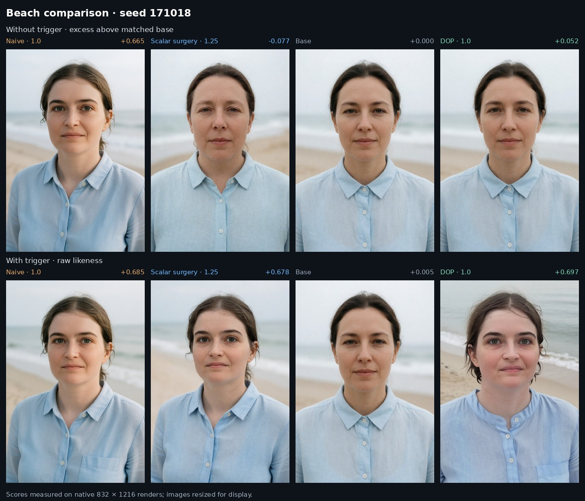

# DeTangle

Delta surgery for **Krea 2 and your own trained LoRA**: refit the adapter to reduce its response to generic prompts while retaining its response when the trigger is requested.

The workflow is to capture activations with your original LoRA active, solve a repaired adapter, then compare both adapters and the base model on matching prompts and seeds. The examples here show where that separation works and where likeness is lost. The illustrated adapters are not included; use your own LoRA for the workflow below.

[Open DeltaScope: interactive comparisons and research guide](https://matlowai.github.io/DeTangle/).



**Naive 1.0 · Scalar surgery 1.25 · Base · DOP 1.0**, seed 171018, matching the app's default beach view. Top scores are similarity above the matched base without the trigger; bottom scores are raw triggered likeness. Scores were measured on the native images; this sheet uses resized display copies. DOP is a separately trained comparator, not an output of the repair command.

## Use Krea 2 with your own LoRA

Requires Python 3.10 or later. The historical solver mode below requires a CUDA-capable PyTorch installation.

```bash
python -m venv .venv
source .venv/bin/activate
python -m pip install -e .
```

You need three inputs:

1. Your Krea 2 LoRA checkpoint, with paired `*.lora_A.weight` and `*.lora_B.weight` matrices.
2. Layer-input captures from generic class prompts, saved as `class-fit.safetensors`.
3. Layer-input captures from triggered prompts, saved as `trigger-fit.safetensors`.

Collect both capture sets with the **same Krea 2 model condition and the unmodified LoRA active**; the historical experiments used adapter strength 1.0. Keep noise, timesteps and prompt/latent pairing controlled, and record the settings. A capture tensor contains sampled input rows immediately before the corresponding LoRA A projection.

**The model-specific activation collector is not bundled yet.** This release starts from saved activation matrices. Use your inference or training backend's hooks to collect them, following the [capture schema](docs/captures.md). The solver does not load Krea 2 or collect these inputs automatically. Capturing on the training checkpoint and rendering with Krea 2 Turbo are different conditions and should be recorded explicitly.

Run the repair once those files exist:

```bash
detangle repair \
  --checkpoint your-krea2-lora.safetensors \
  --class-capture class-fit.safetensors \
  --trigger-capture trigger-fit.safetensors \
  --mu 0.3 --ridge 0.001 --center zero --method historical \
  --out repaired.safetensors
```

This refits A while keeping B and all other tensors unchanged. It preserves the source file, tensor names/shapes/dtypes and original metadata, and writes `repaired.json` with hashes and fitting diagnostics. Existing outputs are refused.

### Numerical modes

- **`--method historical`** follows the recorded solver's arithmetic: CUDA float32 primal Cholesky for input widths up to 8,192 with TF32 disabled, CPU float64 primal solves for larger widths, then the historical float32 intermediate before restoring checkpoint dtype. Use this mode when comparing with the historical repair.
- **`--method auto`** uses the stable CPU float64 solver and chooses a primal or dual system by matrix size. It solves the same objective, but floating-point differences can produce different weights and rendered images. A CPU-only PyTorch installation is sufficient for this mode.

Exact reproduction also requires matching checkpoints, captures and runtime. Large captures can require substantial RAM.

The settings above use the illustrated scalar repair's objective: mu 0.3 and relative ridge 0.001. They are a starting experiment, not established settings for every LoRA. Mu controls the preservation term; ridge controls regularization. The 1.25 strength shown in the comparison is an inference multiplier applied later. See [the mechanism](docs/mechanisms.md) for the equation and the distinction between these parameters.

## Evaluate the repair

Collect separate evaluation captures, then check the repaired layer responses:

```bash
detangle evaluate \
  --source your-krea2-lora.safetensors \
  --edited repaired.safetensors \
  --edit-report repaired.json \
  --class-capture class-heldout.safetensors \
  --trigger-capture trigger-heldout.safetensors \
  --out heldout.json
```

This verifies the A-only edit and measures full `BA` responses on the supplied inputs. A fresh token draw and new prompts test different kinds of generalization; different file hashes alone do not establish independence.

Load `repaired.safetensors` in your Krea 2 rendering workflow. Render the base model, original LoRA and repaired LoRA with matching prompts, seeds and sampling settings. Include prompts with and without your trigger, and inspect requested likeness, generic identity excess and image quality together. A good activation fit does not guarantee a good render.

## Compare and score with DeltaScope

The companion [DeltaScope app](lab/README.md) opens on the beach example above. It also includes the creative-scene comparisons, method explanations, research notes and broader aggregate results.

```bash
python -m pip install ./lab
deltascope serve
```

The viewer runs without PyTorch or a GPU. To use your own renders, follow the [CSV import and scoring workflow](lab/README.md#bring-your-own-images-and-measurements). Optional evaluators include face similarity and image RMSE, with a Python plugin interface for other measurements. Use the [Pages guide](docs/pages.md) to build a static comparison site.

The supplied examples use one character and selected prompts. The [creative-scene case study](docs/case-study.md) examines successful preservation and the space-station and wizard-workshop failures. [Exact prompts, settings and scores](examples/creative-scenes/README.md) accompany those examples. Other concepts and models require appropriate measurements and a compatible adapter format.

## Verification and runtime

The [real-model check](docs/real-model-validation.md) reproduces all 256 historical A tensors and both rendered beach prompt states exactly with `--method historical`. It also reports capture, solve and rendering times, and the numerical difference from the stable CPU mode.

## Optional: a small algebra demo

For an explanation of the solver before collecting model activations:

```bash
detangle demo --out demo-output
```

This creates synthetic matrices and compares zero-centered and source-centered ridge on an unobserved input direction. It explains the algebra; it does not run Krea 2 or demonstrate image-model performance.

To run the checks, install the test dependency as well:

```bash
python -m pip install -e '.[test]'
python -m unittest discover -s tests -v
```

`delta-surgery` and `python -m delta_surgery_seed` are aliases for the `detangle` command.

MIT licensed by MatlowAI; see [LICENSE](LICENSE) and [NOTICE](NOTICE). The original research package's license remains separate.
