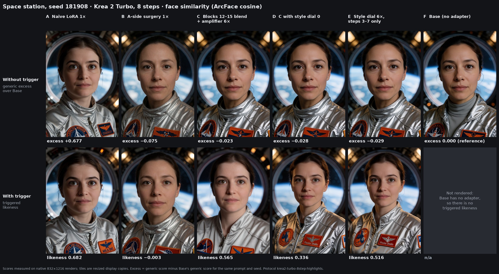
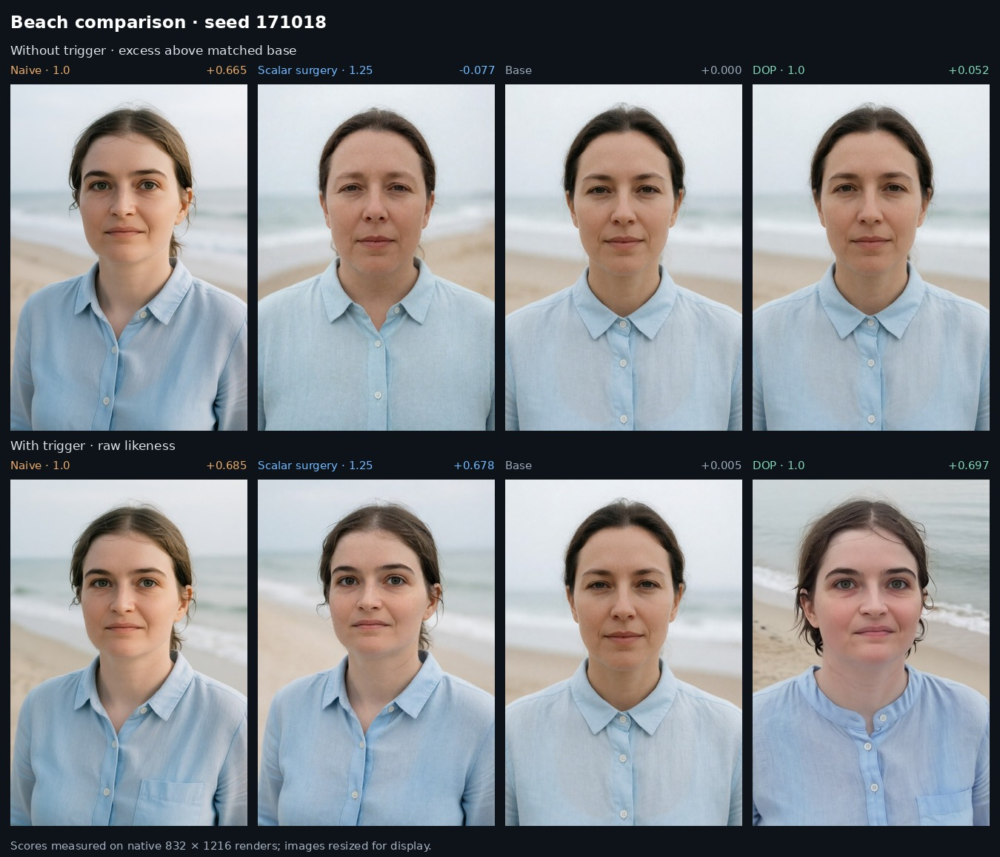

**[Open the DeltaScope website →](https://matlowai.github.io/DeTangle/)**

# DeTangle

Gradient-free repair for **Krea 2 and your own trained LoRA**: stop a character adapter from leaking into prompts that don't ask for it, and keep it working when the trigger is used. All edits are closed-form changes to a finished adapter's weights, with no retraining.



| | Intervention | Bleed without trigger ↓ | Likeness with trigger ↑ |
|---|---|---:|---:|
| A | Original LoRA 1× | +0.677 | 0.682 |
| B | A-side surgery 1× | −0.075 | −0.003 |
| C | B + 35 % of the original A factors in blocks 12–15 + trigger amplifier 6× | −0.023 | 0.565 |
| D | C with the photo-style part of the amplifier at 0 | −0.028 | 0.336 |
| E | C with the style part at 6× on sampling steps 3–7 only | −0.029 | 0.516 |
| F | Base model | 0.000 | n/a |

*Krea 2 Turbo, seed 181908. Face-embedding cosine similarity, not a percentage. Bleed is the untriggered face's similarity to the character minus Base's for the same prompt and seed.*

The original LoRA (A) puts the character into every portrait, asked for or not. A-side surgery (B) removes that bleed, but in strong-prior scenes like this sci-fi film still, the base model's prior for a familiar movie-star face then overpowers the trigger and the character is gone. C, D and E get her back without bringing the bleed back:
- C restores part of the original adapter only in the blocks that carry identity.
- C also adds a closed-form amplifier for the trigger in the text conditioning.
- D and E split that amplifier into a photo-style part and an identity part, and E applies the style part only during the sampling steps where identity is written.

On held-out seeds, the composite repair matches the original LoRA's likeness (0.73 vs 0.72 over nine scenes; 0.63 vs 0.65 on six film genres never used in fitting) while cutting generic bleed from +0.71 to +0.06.

- **[Composite repair walkthrough](docs/composite-repair.md)**: each step in weight terms, why B fails, held-out validation, block localization, step scheduling, group shots and name binding, limits.
- **[What this work demonstrates](docs/findings.md)**: capability summary, key tables and open directions.
- **[Reproduction check](docs/composite-repair-validation.md)**: the commands below reproduce every tensor of the research adapters bit-for-bit, and the step-scheduled renders pixel-for-pixel.
- **[For agents](AGENTS.md)**: how to pick up this repo and apply the method to another LoRA.

The illustrated adapter is not distributed. Use your own LoRA for the workflows below.

## Use Krea 2 with your own LoRA

Requires Python 3.10 or later. The historical solver mode below requires a CUDA-capable PyTorch installation.

```bash
python -m venv .venv
source .venv/bin/activate
python -m pip install -e .
```

You need three inputs:

1. Your Krea 2 LoRA checkpoint, with paired `*.lora_A.weight` and `*.lora_B.weight` matrices.
2. Layer-input captures from generic class prompts, saved as `class-fit.safetensors`.
3. Layer-input captures from triggered prompts, saved as `trigger-fit.safetensors`.

Collect both capture sets with the **same Krea 2 model condition and the unmodified LoRA active**; the historical experiments used adapter strength 1.0. Keep noise, timesteps and prompt/latent pairing controlled, and record the settings. A capture tensor contains sampled input rows immediately before the corresponding LoRA A projection.

`detangle collect-layers` collects these on a ComfyUI checkout with Krea 2 (install the `krea2` extra; see the [composite repair section](#composite-repair-blocks-amplifier-and-step-schedule)). You can also use your own backend's hooks, following the [capture schema](docs/captures.md). The historical captures came from the training runtime, and the bundled collector is a new capture condition: it has been smoke-tested end to end but not compared with them. Capturing on the training checkpoint and rendering with Krea 2 Turbo are different conditions and should be recorded explicitly.

Run the repair once those files exist:

```bash
detangle repair \
  --checkpoint your-krea2-lora.safetensors \
  --class-capture class-fit.safetensors \
  --trigger-capture trigger-fit.safetensors \
  --mu 0.3 --ridge 0.001 --center zero --method historical \
  --out repaired.safetensors
```

This refits A while keeping B and all other tensors unchanged. It preserves the source file, tensor names/shapes/dtypes and original metadata, and writes `repaired.json` with hashes and fitting diagnostics. Existing outputs are refused.

### Numerical modes

- **`--method historical`** follows the recorded solver's arithmetic: CUDA float32 primal Cholesky for input widths up to 8,192 with TF32 disabled, CPU float64 primal solves for larger widths, then the historical float32 intermediate before restoring checkpoint dtype. Use this mode when comparing with the historical repair.
- **`--method auto`** uses the stable CPU float64 solver and chooses a primal or dual system by matrix size. It solves the same objective, but floating-point differences can produce different weights and rendered images. A CPU-only PyTorch installation is sufficient for this mode.

Exact reproduction also requires matching checkpoints, captures and runtime. Large captures can require substantial RAM.

The settings above use the illustrated scalar repair's objective: mu 0.3 and relative ridge 0.001. They are a starting experiment, not established settings for every LoRA. Mu controls the preservation term; ridge controls regularization. The 1.25 strength shown in the comparison is an inference multiplier applied later. See [the mechanism](docs/mechanisms.md) for the equation and the distinction between these parameters.

## Evaluate the repair

Collect separate evaluation captures, then check the repaired layer responses:

```bash
detangle evaluate \
  --source your-krea2-lora.safetensors \
  --edited repaired.safetensors \
  --edit-report repaired.json \
  --class-capture class-heldout.safetensors \
  --trigger-capture trigger-heldout.safetensors \
  --out heldout.json
```

This verifies the A-only edit and measures full `BA` responses on the supplied inputs. A fresh token draw and new prompts test different kinds of generalization; different file hashes alone do not establish independence.

Load `repaired.safetensors` in your Krea 2 rendering workflow. Render the base model, original LoRA and repaired LoRA with matching prompts, seeds and sampling settings. Include prompts with and without your trigger, and inspect requested likeness, generic identity excess and image quality together. A good activation fit does not guarantee a good render.

## Composite repair: blocks, amplifier and step schedule

A-side surgery alone can lose the character in strong-prior scenes (rung B above). The composite repair rebuilds rungs C to E from your own adapter. Install the Krea 2 extra and point the commands at a ComfyUI checkout that has Krea 2 Turbo:

```bash
python -m pip install -e '.[krea2]'
export DETANGLE_COMFYUI=/path/to/ComfyUI
```

```bash
# C, part 1: restore 35 % of the original A factors in main blocks 12-15
detangle blend --source your-krea2-lora.safetensors --repaired repaired.safetensors \
  --blocks 12-15 --fraction 0.35 --out blend.safetensors

# C, part 2: fit a closed-form trigger amplifier on txtmlp.3.
# The spec lists triggered prompts to strengthen and untriggered prompts to hold fixed.
detangle collect-text --diffusion-model krea2-turbo.safetensors --text-encoder qwen3-vl-4b.safetensors \
  --lora repaired.safetensors --spec amp-spec.json --out text-captures.safetensors
detangle amp-fit --spec amp-spec.json --captures text-captures.safetensors --out amp.safetensors

# D: split the amplifier into a photo-style part and the rest
detangle amp-fit --spec amp-spec.json --captures text-captures.safetensors --part style --out amp-style.safetensors
detangle amp-fit --spec amp-spec.json --captures text-captures.safetensors --part rest  --out amp-rest.safetensors

# E: render with the blend, the style-free amplifier at 6x, and the style part at 6x on steps 3-7 only
detangle render --diffusion-model krea2-turbo.safetensors --text-encoder qwen3-vl-4b.safetensors --vae qwen-image-vae.safetensors \
  --lora blend.safetensors --lora amp-rest.safetensors:6 --schedule amp-style.safetensors:6:3-7 \
  --prompt "your-trigger, ..." --seed 181908 --out e.png
```

`detangle compose` packages a blend plus dosed amplifier parts into one LoRA file for ordinary workflows. A packaged file renders slightly differently from loading the parts separately, because ComfyUI rounds a weight difference to its compute dtype before applying strength. Load the parts separately when you need exact reproduction. Step scheduling currently runs through the bundled in-process pipeline (`detangle render`, or `ScheduledDelta` in Python), not through stock ComfyUI nodes. The settings above (35 %, blocks 12–15, 6×, steps 3–7) were selected for one character; treat them as a starting point. See the [walkthrough](docs/composite-repair.md) for how each was chosen and the [reproduction check](docs/composite-repair-validation.md) for exact arguments and the spec format. The scripts that produced the published findings are in [research/](research/README.md).

## Compare and score with DeltaScope

The companion [DeltaScope app](lab/README.md) opens on the space-station ladder above. It also includes the beach and creative-scene comparisons, method explanations, research notes and broader aggregate results.



**Naive 1.0 · Scalar surgery 1.25 · Base · DOP 1.0**, seed 171018: the first-release beach example, where A-side surgery alone already preserves likeness. Top scores are similarity above the matched base without the trigger; bottom scores are raw triggered likeness. Scores were measured on the native images; this sheet uses resized display copies. DOP is a separately trained comparator, not an output of the repair command.

```bash
python -m pip install ./lab
deltascope serve
```

The viewer runs without PyTorch or a GPU. To use your own renders, follow the [CSV import and scoring workflow](lab/README.md#bring-your-own-images-and-measurements). Optional evaluators include face similarity and image RMSE, with a Python plugin interface for other measurements. Use the [Pages guide](docs/pages.md) to build a static comparison site.

The supplied examples use one character and selected prompts. The [creative-scene case study](docs/case-study.md) examines successful preservation and the space-station and wizard-workshop failures. [Exact prompts, settings and scores](examples/creative-scenes/README.md) accompany those examples. Other concepts and models require appropriate measurements and a compatible adapter format.

## Verification and runtime

The [real-model check](docs/real-model-validation.md) reproduces all 256 historical A tensors and both rendered beach prompt states exactly with `--method historical`. It also reports capture, solve and rendering times, and the numerical difference from the stable CPU mode.

## Research notes

- [Composite repair](docs/composite-repair.md) and [findings](docs/findings.md): the space-station ladder, held-out validation, block localization, step scheduling and name binding.
- [Research scripts](research/README.md): the as-run study code behind each finding, with a script-to-finding map.
- [Lessons](docs/lessons.md): short-form findings since the first release, including name binding and the frozen-test result.
- [Prompt-dependent preservation](docs/prompt-dependent-preservation.md): the controlled capture-recipe follow-up, with paired renders, a fixed-input probe and a numerical-reproducibility check.
- [Roadmap](docs/roadmap.md): open directions.
- [Attributions](docs/attributions.md): ideas from other work and where they are credited.

## Why I'm sharing this

I'd been letting these experiments collect dust for a few months. Seeing [Fizgig's](https://github.com/shootthesound/Fizgig) recent release and the current mechanistic interpretability conversations nudged me to share them. Fizgig is the more mature, fully featured toolkit; I hope this smaller research release helps someone too.

Fizgig's block-weight controls scale the existing LoRA contribution in each block, with profiling and ablations to help inspect the effects. Delta surgery refits the LoRA's A factors from generic and triggered activation captures, keeping B fixed, to change which inputs it responds to. Fizgig also has separate [DOP-based LoRA Isolation training](https://github.com/shootthesound/Fizgig/blob/master/docs/LORA_ISOLATION.md); the comparison here is specifically with its block-weight repair tools.

I'm also following Nick Cammarata's Goodfire essay, [Neural Networks Are Already Clean](https://already-clean.goodfire.com/), a working hypothesis about studying native neurons and circuits directly. I'd like to explore how these adapter experiments can connect with that wider MI work through better probes and controlled interventions. For now, I'm sharing the code, comparisons and failure cases in case they're useful.

## Optional: a small algebra demo

For an explanation of the solver before collecting model activations:

```bash
detangle demo --out demo-output
```

This creates synthetic matrices and compares zero-centered and source-centered ridge on an unobserved input direction. It explains the algebra; it does not run Krea 2 or demonstrate image-model performance.

To run the checks, install the test dependency as well:

```bash
python -m pip install -e '.[test]'
python -m unittest discover -s tests -v
```

`delta-surgery` and `python -m delta_surgery_seed` are aliases for the `detangle` command.

MIT licensed by MatlowAI; see [LICENSE](LICENSE) and [NOTICE](NOTICE). The original research package's license remains separate.
