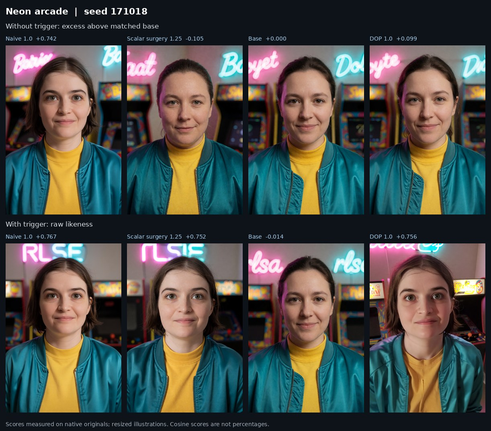
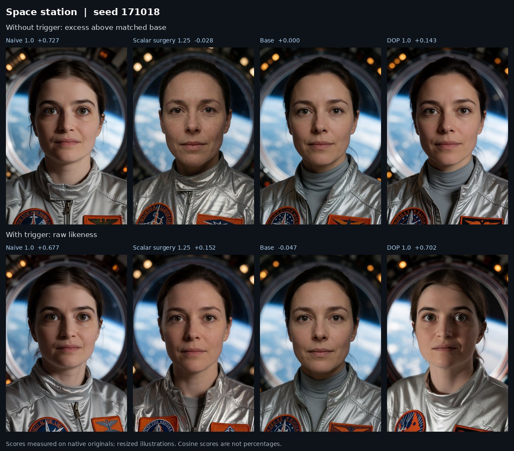

# Case study: preservation depends on the prompt

The same scalar-surgery adapter preserves much of the source likeness in a neon arcade and loses most of it in a space-station portrait. Both suppress the measured generic identity bleed. That contrast is the useful finding: the identity remains reachable, but the intervention does not preserve it across these prompt conditions.

The comparison uses one character, four deliberately chosen scenes, two seeds, and both trigger states. Every image has a detected face. The triggered prompt adds only `rlsa, ` to the exact generic description; both keep the `woman` class cue and request no age. All remaining prompt text and render settings stay paired. These are exploratory cases chosen for inspection, not an untouched benchmark.

## Measurements

Mean over seeds 171017 and 171018. Each cell is **triggered likeness / generic excess above matched base**. Both are cosine-based scores; neither is a percentage.

| Scene | Naive 1.0 | Scalar surgery 1.25 | DOP 1.0 |
|---|---:|---:|---:|
| Neon arcade | 0.764 / +0.722 | 0.729 / −0.103 | 0.750 / +0.115 |
| Stormy lighthouse | 0.667 / +0.700 | 0.624 / −0.007 | 0.737 / +0.095 |
| Space station | 0.667 / +0.721 | 0.134 / −0.019 | 0.698 / +0.098 |
| Wizard workshop | 0.728 / +0.725 | 0.332 / −0.058 | 0.747 / +0.109 |

Each likeness cell has two detected faces from two images; each generic cell has two detected, matched base pairs. Base is shown in every contact sheet and in the machine-readable scores. Negative excess means less target-centroid similarity than base, not intrinsically better preservation. The 160-row score file retains all rendered strengths, including 1.0, 1.25 and 1.5 for each adapter; the figure defaults are a selected operating point.





In the arcade, scalar surgery retains nearly the naive adapter's measured likeness while separating the generic row. In the space station, low generic excess coexists with a major triggered-likeness failure. The lighthouse and wizard workshop show that preservation varies by degree, not only a binary success/failure split. DOP retains more identity on the difficult scenes at this selected strength, with higher generic excess than scalar surgery.

## How the scores were calculated

The scorer detects faces with InsightFace's `buffalo_l` pipeline and selects the largest bounding box. It compares that face's normalized ArcFace embedding with a normalized centroid made from 34 normalized reference embeddings:

```text
reference = normalize(mean(normalize(reference_embeddings)))
likeness = dot(normalize(generated_face_embedding), reference)
generic_excess = generic_likeness(adapter) - generic_likeness(matched_base)
```

The matching base uses the same exact prompt, seed, and rendering setup. Missing detections must remain missing; they cannot be counted as successful suppression. These examples happen to have 160 detections in 160 images. Scores were measured on native 832 × 1216 images; the JPEG sheets are resized illustrations. Neither reference images nor their embeddings are distributed, so the historical face scores cannot be independently recomputed from this seed alone.

## What the original scan did cover

The selected repair used mu 0.3, relative ridge 0.001 and a zero-centered prior. It sampled 1,024 input tokens per layer and role over six flow fractions: 0.1, 0.25, 0.4, 0.55, 0.7 and 0.85. The noise seed was 42. The selected historical reservoir draw was unseeded; later repeat controls used 1001 and 1002.

An audit found that the historical expansion was truncated: 72 prompts and 72 latents were actually consumed. Of those prompts, 71 used explicit age descriptions. The triggered role prepended `rlsa, ` to those same descriptions. There were no astronaut, spaceflight or wizard examples in the consumed pool. A text match for “space” came from a coworking-space description. Captures used the training base-model condition; these comparison images use Krea 2 Turbo deployment.

These are concrete mismatches worth testing. They do not prove that missing an astronaut prompt caused the failure. The new scene also changes garment, lighting, expression and genre phrasing. The scan's random token draw and zero-centered treatment of uncovered directions are separate possibilities, as are interactions among edits to different layers.

## Lessons and next experiments

1. **Keep preservation beside suppression.** A low bleed score alone would make the space-station failure look successful. Always render and score both trigger states.
2. **Inspect actual coverage.** A large intended prompt file is not evidence that its entries reached the capture loop. Record consumed prompt IDs, sample counts and seeds.
3. **Separate the knobs.** Mu changes the refit; ridge changes the regularization; rendering strength scales the finished adapter. Strength 1.25 is not mu 1.25.
4. **Use paired rescans.** Hold source checkpoint, sample budget, flow fractions, noise, reservoir seed and evaluation prompts fixed while changing only the scan pool. Include a rerun of the old pool as a sampling control.
5. **Reserve a new test split.** Arcade and space-station examples helped discover this issue. They can be development probes, but adding them to the scan makes them unsuitable as unseen validation.
6. **Probe before claiming a mechanism.** Compare held-out `BA` responses per layer and rerun the edited model to capture the changed trajectory. Restore or edit selected blocks and render paired seeds to test whether a candidate change actually mediates the failure.

A useful next scan pool varies everyday portraits, unfamiliar settings, clothing and lighting while keeping the positive capability clear. Compare training-condition and deployment-condition captures separately. A source-centered ridge arm tests the uncovered-direction prior; repeated reservoir seeds test variance. Include simple prompt-component controls, such as changing only the background or only the flight suit, before attributing the effect to the word “astronaut.”

The code here supports the refit and fixed-input response evaluation for that work. New controlled rescan outcomes are not yet included in this historical case study. Character identity is the first case; other concepts need task-specific positive-capability and collateral-effect metrics.

[All scene illustrations and exact settings](../examples/creative-scenes/README.md) · [Mechanism](mechanisms.md) · [Capture contract](captures.md)
