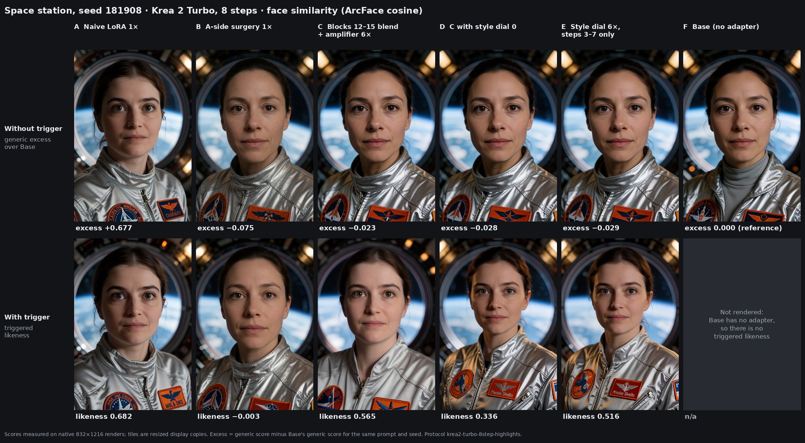

# Composite repair: getting the character back in strong-prior scenes

Scalar surgery removes most of a character LoRA's bleed into prompts that do not ask for the character. In some scenes it also removes the character when she is asked for. The space-station portrait is the clearest example. This page walks through the repair that recovered her there, one weight change at a time, and the evidence that it holds on seeds and genres that were not used to choose it.

All scores are face similarity: the ArcFace cosine of the largest detected face to a normalized centroid of 34 reference-face embeddings. It is not a percentage. **Likeness** is the score of a render whose prompt contains the trigger. **Generic excess** is the score of the same prompt without the trigger, minus Base's score for that prompt and seed; positive values mean the face moved toward the character when nobody asked for her.



*Krea 2 Turbo, 8 Euler steps, 832 × 1216, seed 181908, protocol `krea2-turbo-8step-highlights`. Scores were measured on the native renders; the sheet uses resized display copies. Source images, hashes and scores: [provenance](../examples/space-station-ladder-181908.json).*

## The ladder

| | Condition | Generic excess | Likeness |
|---|---|---:|---:|
| A | Naive LoRA 1× | +0.677 | 0.682 |
| B | A-side surgery 1× | −0.075 | −0.003 |
| C | B + 35 % blend in blocks 12–15 + trigger amplifier 6× | −0.023 | 0.565 |
| D | C with the style dial at 0 | −0.028 | 0.336 |
| E | C with the style dial at 6×, sampling steps 3–7 only | −0.029 | 0.516 |
| F | Base (no adapter) | 0.000 | n/a |

One seed is shown. Over all four seeds of the same cohort (181905–181908), the picture is the same:

| Condition | Likeness, per seed | Mean likeness | Mean generic excess |
|---|---|---:|---:|
| A Naive LoRA 1× | 0.701 · 0.672 · 0.679 · 0.682 | 0.683 | +0.678 |
| B A-side surgery 1× | 0.015 · −0.050 · 0.003 · −0.003 | −0.009 | −0.075 |
| C Repair, amplifier 6× | 0.636 · 0.604 · 0.663 · 0.565 | 0.617 | −0.009 |
| D Style dial 0 | 0.392 · 0.307 · 0.365 · 0.336 | 0.350 | −0.001 |
| E Style dial 6×, steps 3–7 | 0.534 · 0.513 · 0.588 · 0.516 | 0.538 | −0.004 |

Seed 181908 is the weakest of the four for C. Base was not rendered with the trigger in this cohort; it has no adapter to trigger.

In the untriggered row, B to E draw closely similar women, and none of them is the character. They are not identical to Base either: at this seed the suit collar differs. That is A-side surgery's own collateral, which the later steps inherit (see [limits](#limits)).

This cohort was rendered through the study's in-process pipeline: same model, adapters, sampler and seeds as the render server, but with LoRA patches baked into the FP8 weights. Pixels and scores therefore differ slightly from the server renders used in the [held-out validation](#held-out-validation) below.

## The problem B exposes

Read the two rows of A first. The naive adapter reproduces the character with the trigger (0.682), and it also draws her when the prompt only asks for "a woman" (+0.677). That untriggered row is the bleed scalar surgery was built to remove.

B removes it: the untriggered face returns to a stranger (−0.075). But the triggered face is also a stranger (−0.003). In everyday scenes A-side surgery keeps a useful part of the likeness; in sci-fi and fantasy "film still" prompts it does not. In those scenes the base model has a strong default face for the setting, and the weakened trigger loses to it. Against the model's own renderings of named actresses, that fallback face resembles a blend of space-film leads, not any one person.

The repair below does not touch that default face. It makes the trigger strong enough to win again, in places where doing so does not bring the bleed back.

## What each step changes

Every adapted layer of the character LoRA adds a low-rank update to a frozen base weight:

```text
y = W x + s (alpha / rank) B A x          rank 32, alpha 32, render strength s
```

**A. Naive LoRA.** The trained adapter at strength 1. Nothing is edited.

**B. A-side surgery.** Each layer's input factor A is refit in closed form. Layer inputs are captured with the original adapter active, on generic class prompts (Xc) and triggered prompts (Xt). The new A′ minimizes the generic response while penalizing changes to the triggered response:

```text
minimize over A′:  ||A′ Xc||² + μ ||(A′ − A) Xt||² + ε ||A′||²
A′ (Gc + μ Gt + εI) = μ A Gt          Gc = Xc Xcᵀ,  Gt = Xt Xtᵀ
μ = 0.3, relative ridge 0.001, solved in CPU float64
```

B is unchanged in every layer. No gradient step is taken.

**C. Block blend + trigger amplifier.** Two edits are added to B.

1. *Blend.* In main blocks 12–15 only, 35 % of the original A is restored: `A_C = A′ + 0.35 (A − A′)`. Because B is shared, this is an exact blend of the two weight updates in those blocks: `B A_C = B A′ + 0.35 B (A − A′)`. Every other block keeps A′.
2. *Amplifier.* Krea 2's text tokens reach the image blocks only through `txtmlp(txtfusion(context))`, computed once per prompt. With the A-side adapter loaded, the trigger changes that conditioning by about 47 % of its norm, and the change is easy to isolate. A least-squares edit of the last text projection, `txtmlp.3` (6144 × 6144), is fitted so that 119 triggered prompts move further along their own trigger offset while 390 untriggered prompts stay where they are. The edit is stored as a weight difference and applied at dose 6. No image-block weight changes. On held-out triggered prompts the fit reached 97–99 % of its target; held-out untriggered conditioning moved by 2–6 % of its norm.

**D. Style dial at 0.** The trigger offset is split into two parts: its projection on snapshot ↔ cinematic directions, measured from prompt pairs such as "casual smartphone snapshot, flat lighting, everything in focus" versus "cinematic film still, dramatic lighting, shallow depth of field", and the remainder. Each part gets its own closed-form amplifier. With both at 6 the sum is C's amplifier. D keeps the remainder at 6 and sets the style part to 0. The blend is unchanged.

**E. Style dial 6×, steps 3–7.** The same two amplifiers as D, but the style part is used at 6 only on sampling steps 3–7 of 8. Steps 0–2 run without it. The remainder and the blend act on every step.

**F. Base.** No adapter: ΔW = 0.

## Why A-side surgery fails here

Swapping adapter factors block by block (one render per hybrid, 128 renders) localized the space-station failure to main blocks 8–15. Every other window, including blocks 0–3, did nothing. Restoring the original factors in blocks 8–11 brought likeness back to 0.43, but generic excess rose by +0.30.

In those blocks, the directions that let the character override a strong scene prior are the same directions that carry her into untriggered prompts. A-side surgery only sees layer-input statistics; it cannot keep one use of a direction and drop the other. The historical capture pool also contained no astronaut or wizard prompts, so nothing in the fit asked the solve to protect those scenes.

The fallback face is not the cause. Text edits that pushed the scene's default face away from the actress blend changed the generic woman, but once triggered prompts were protected in their fit they no longer changed the character's likeness (space station 0.61 → 0.61–0.62). What mattered was the strength of the triggered conditioning itself.

## How C, D and E recover likeness

C uses two places that cost little or no bleed.

- **The text path.** The amplifier only changes conditioning for prompts that contain the trigger, so untriggered prompts render as with B. On six unseen film genres (development seeds 181901–181904) the amplifier alone restored likeness to 0.60, against 0.10 for A-side, with no added generic excess (−0.035 vs −0.027 for A-side).
- **Blocks 12–15.** Partial restoration in the late half of the failing window adds identity detail (0.21 likeness alone on the same six genres) for a small bleed cost (generic excess +0.05). Restoring more costs bleed quickly: in the scheduling study, raising the blend from 35 % to 100 % took likeness 0.41 → 0.56 and untriggered drift toward her +0.05 → +0.28, with the look unchanged.

Together they reach 0.565 at seed 181908 and 0.617 across the four highlight seeds, with generic excess at Base level.

C has a visible cost. A trigger learns everything common to its training photos, and amplifying it amplifies all of it: flatter frontal lighting, simpler clothing, less background blur. On six unseen genres, C's scenes were further from Base than the original LoRA's once the face is masked (DINOv2 similarity 0.69 vs 0.80). Higher doses add wardrobe drift toward the training photos' clothing.

D removes that style part entirely. Scenes and costumes stay closer to Base, and likeness falls to 0.336. The fall is the evidence that part of the likeness was riding on the style direction.

E restores most of it without the look. The face is refined in the late sampling steps; composition, lighting and costume are decided in the first ones. Holding the style part back for steps 0–2 recovers 0.516 at this seed (0.538 over four seeds) while keeping D's lighting and costume. In the sheet, D and E share the warmer light and suit detail of the untriggered renders; C moves toward A's flatter look.

## Held-out validation

The repair was chosen on seeds 181901–181904. All numbers in this section come from seeds 181905–181908. The nine protocol scenes include the development scenes (space station, wizard workshop); for them only the seeds are new. The six film genres (film noir, Victorian ballroom, western saloon, superhero rooftop, Viking longhouse, samurai village) were never used in any fit or selection. Four seeds per scene, server renders, protocol `krea2-turbo-8step-fresh`.

| Prompt set | Original LoRA | A-side | Repair 6× |
|---|---:|---:|---:|
| Nine protocol scenes, likeness | 0.72 | 0.44 | 0.73 |
| Space station, likeness | 0.67 | 0.01 | 0.65 |
| Wizard workshop, likeness | 0.73 | 0.14 | 0.69 |
| Six unseen genres, likeness | 0.65 | 0.10 | 0.63 |
| Nine protocol scenes, generic excess | +0.71 | −0.04 | +0.06 |
| Six unseen genres, generic excess | +0.66 | −0.05 | +0.03 |

On a wider bleed panel of 70 held-out untriggered prompts (everyday and sci-fi women, men, four named actresses; two seeds), the original LoRA pushed 68 faces above 0.35 toward the character; the repair at 6× pushed none, with mean excess +0.02 to +0.05.

Two genres yield less. Viking longhouse reached 0.51 against 0.71 for the original LoRA, and samurai village 0.25 against 0.41. Refitting the amplifier with 16 additional film-genre scenes (none of these six) lifted Viking to 0.70 and the six-genre mean to 0.67, at the cost of a new untriggered drift in the western saloon (+0.24, below the 0.35 flag).

## Block localization

At 50 % blend with the amplifier at 4×, the two halves of the failing window behave differently on the space station:

| Blend window (50 %, amplifier 4×) | Likeness | Generic excess |
|---|---:|---:|
| Blocks 8–11 | 0.48 | +0.12 |
| Blocks 12–15 | 0.55 | +0.06 |

Blocks 12–15 carry more likeness per unit of bleed; blocks 8–11 mostly carry bleed. Over blocks 8–15 together, generic bleed has a threshold: about +0.04 at 25 %, +0.30 at 50 % and +0.52 at 75 %. The selected 35 % of blocks 12–15 with the amplifier at 6× reached 0.63 at +0.00 on two development seeds.

## Scheduling over sampling steps

Every fixed edit of the trigger conditioning that was tested bought likeness by adding the training photos' look, by changing the scene, or both. Twenty candidate components were scored (principal directions, the style dial, identity subspaces and four random-direction controls), and the best combination of 16 was searched for. On six held-out genres it did not beat the plain style dial. Applying the style part only on later steps did.

Six unseen genres, n = 24, each value relative to style dial 0 (24 renders per arm were run; the 12 on seeds 181905–181906 are in the published DeltaScope records):

| Edit | Likeness | Snapshot score | Scene vs Base |
|---|---:|---:|---:|
| Style dial 3, fixed | +0.15 | +0.029 | −0.022 |
| Best combination of 16 components, fixed | +0.13 | +0.022 | −0.045 |
| Style dial 6, steps 3–7 only | +0.15 | +0.011 | −0.005 |

Applied per unit dose in a single window (32 contexts), the style dial adds +0.020 likeness in the late steps 6–7 with no measurable snapshot or scene change, and +0.013 in the early steps 0–2 while moving the scene by −0.014. The block blend and the text amplifier spend different currencies: the blend pays in bleed, the amplifier pays in look. Scheduling the amplifier is the first lever found that lowers the cost instead of moving it.

## Group shots and name binding

Single-portrait scores miss one failure. Put the character in a photo with other people and the repaired adapter gives them her face as well: in the cafe scene, 8 of 8 other faces scored at or above 0.35 for every variant, and in a space crew of two men the repair turned 8 of 8 as well.

The base model already knows how to keep two named people apart. From layer 12, image tokens identify each tested celebrity from the face alone. The character's identity points one consistent way, but only 1–3 % of it lies in the directions the model uses to tell celebrities apart. A set of attention heads in layers 7–11 sends each face to its own name; the strongest, layer 9 head 15, scores 0.86 (own minus other name). In those heads a celebrity's face gives about 0.67 of its attention to its own name, and faces give the trigger 0.01–0.03. Names bind to one face; the trigger arrives everywhere at once.

A later closed-form binding fold that makes the trigger present a name's key is described in [lessons](lessons.md#binding-names-are-entities-to-the-text-encoder-2026-10-21--10-25). It is a separate adapter with its own trade-offs and is not part of this ladder.

## Limits

- One character and one private adapter. The adapters are not distributed, and neither are the reference images, so the face scores cannot be recomputed from this repository alone.
- Four seeds per cell and a small set of chosen diagnostic scenes. The space station and wizard workshop were development scenes; only their seeds are held out.
- The repair inherits A-side surgery's own side effect. The untriggered face is no closer to the character, but on some scenes it is a different person from Base's (face match to Base ≈ 0.7 on the beach and studio prompts). Look at the untriggered faces, not only their score.
- Named-person prompts are weakened: one named actress, prompted by name, fell from 0.82 to 0.72 against her own concept centroid.
- Generic excess is not uniform across scenes. The wizard workshop shows +0.13 with the repair at 6× on the held-out seeds.
- The amplifier sharpens backgrounds the prompt asks to be softly blurred, and C carries the training photos' look. D and E trade some likeness to remove it.
- Step scheduling ran only on the study's in-process pipeline. ComfyUI's step-scheduling hooks did not run with the FP8-scaled Krea 2 weights in the pinned version, so there is no one-click workflow for E yet.
- Group shots are not fixed by this repair (see above).

[Capability summary](findings.md) · [Research lessons](lessons.md) · [Mechanism](mechanisms.md) · [DeltaScope app](../lab/README.md)
