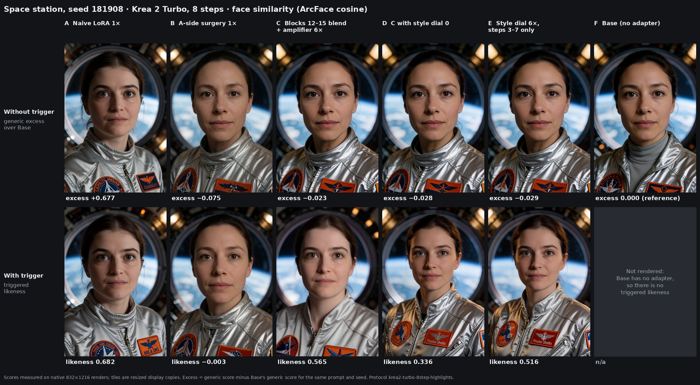

# What this work demonstrates

A compact summary of the composite-repair results on Krea 2 Turbo. The walkthrough, with images and the reasoning behind each step, is in [composite repair](composite-repair.md). All scores are ArcFace cosine similarities to the character's reference centroid; generic excess subtracts Base's score for the same untriggered prompt and seed.

**Demonstrated** means the effect was measured on rendered images with matched seeds and a Base comparison, including held-out seeds. **Investigated** means the mechanism was measured inside the network, but no repair built on it is part of this result.

| Capability | Status | What was shown | Evidence |
|---|---|---|---|
| Gradient-free conditional weight edits | Demonstrated | The full repair is two closed-form edits to a finished adapter's A factors (refit, then a partial blend) and one to a text layer, with no training step. Triggered likeness matches the original LoRA on held-out seeds (0.73 vs 0.72, nine scenes) at a fraction of its bleed (+0.06 vs +0.71). | [Ladder](composite-repair.md#the-ladder), [held-out validation](composite-repair.md#held-out-validation) |
| Closed-form conditional fitting | Demonstrated | A-side refit `A′ (Gc + μ Gt + εI) = μ A Gt`; a least-squares `txtmlp.3` edit that moves 119 triggered prompts along their own trigger offset and holds 390 untriggered prompts. Held-out fit: 97–99 % of target on triggered prompts, 2–6 % change on untriggered ones. | [What each step changes](composite-repair.md#what-each-step-changes), [mechanism](mechanisms.md) |
| Block-level localization | Demonstrated | 128 one-render block swaps localized the failure to blocks 8–15. At 50 % blend, blocks 12–15 give more likeness at less bleed than blocks 8–11. | [Block localization](composite-repair.md#block-localization), [lessons](lessons.md#localize-with-tensor-swaps-before-solving-anything-2026-10-19) |
| Direction separation of the trigger | Demonstrated | The trigger offset splits into a photo-style part and a remainder, each with its own closed-form amplifier. Turning the style part to 0 keeps scenes closer to Base and drops likeness, showing where it was carried. | [How C, D and E recover likeness](composite-repair.md#how-c-d-and-e-recover-likeness) |
| Temporal control over diffusion steps | Demonstrated | Applying the style part only on steps 3–7 of 8 matches the fixed edit's likeness gain (+0.15) with under half of its snapshot shift and almost no scene change. In-process pipeline only. | [Scheduling](composite-repair.md#scheduling-over-sampling-steps) |
| Attention-head identity-binding analysis | Investigated | Names bind to one face through heads in layers 7–11 (best: layer 9 head 15, 0.86); faces give the trigger 0.01–0.03 of their attention in those heads. Explains why the repaired adapter still spreads to other faces in group shots. | [Group shots and name binding](composite-repair.md#group-shots-and-name-binding), [lessons](lessons.md#binding-names-are-entities-to-the-text-encoder-2026-10-21--10-25) |
| Preservation-vs-suppression analysis | Demonstrated | Every condition is scored with and without the trigger. A-side surgery shows suppression without preservation (excess −0.075, likeness −0.003 on the space station); the composite repair restores preservation while keeping suppression. | [The problem B exposes](composite-repair.md#the-problem-b-exposes), [case study](case-study.md) |
| Held-out seeds, scenes and genres | Demonstrated | Chosen on seeds 181901–181904; validated on 181905–181908 over nine scenes and six film genres never used in any fit, plus a 70-prompt untriggered bleed panel (68 faces above 0.35 for the original LoRA, none for the repair). | [Held-out validation](composite-repair.md#held-out-validation) |

## Key results

### Space-station ladder, seed 181908

| | Condition | Generic excess | Likeness |
|---|---|---:|---:|
| A | Naive LoRA 1× | +0.677 | 0.682 |
| B | A-side surgery 1× | −0.075 | −0.003 |
| C | Blocks 12–15 35 % blend + trigger amplifier 6× | −0.023 | 0.565 |
| D | C with style dial 0 | −0.028 | 0.336 |
| E | Style dial 6×, steps 3–7 only | −0.029 | 0.516 |
| F | Base | 0.000 | n/a |

Protocol `krea2-turbo-8step-highlights`. Four-seed means (181905–181908) for C, D and E are 0.617, 0.350 and 0.538.

### Held-out seeds 181905–181908

| Prompt set | Original LoRA | A-side | Composite 6× |
|---|---:|---:|---:|
| Nine protocol scenes, likeness | 0.72 | 0.44 | 0.73 |
| Space station, likeness | 0.67 | 0.01 | 0.65 |
| Wizard workshop, likeness | 0.73 | 0.14 | 0.69 |
| Six unseen genres, likeness | 0.65 | 0.10 | 0.63 |
| Nine protocol scenes, generic excess | +0.71 | −0.04 | +0.06 |
| Six unseen genres, generic excess | +0.66 | −0.05 | +0.03 |

### Block split (50 % blend, amplifier 4×, space station)

| Window | Likeness | Generic excess |
|---|---:|---:|
| Blocks 8–11 | 0.48 | +0.12 |
| Blocks 12–15 | 0.55 | +0.06 |

### Scheduling vs a fixed direction (six unseen genres, n = 24, relative to style dial 0)

| Edit | Likeness | Snapshot shift | Scene vs Base |
|---|---:|---:|---:|
| Style dial 3×, fixed | +0.15 | +0.029 | −0.022 |
| Best fixed combination of 16 components | +0.13 | +0.022 | −0.045 |
| Style dial 6×, steps 3–7 only | +0.15 | +0.011 | −0.005 |

24 renders per arm were run; the 12 on seeds 181905–181906 are in the published DeltaScope records.

### Binding

| Measurement | Value |
|---|---|
| Layer from which image tokens identify each tested celebrity | 12 |
| Share of the character's identity direction inside the celebrity-identity subspace | 1–3 % |
| Binding heads | layers 7–11; strongest layer 9 head 15, 0.86 own minus other |
| Attention a face gives its own name, in those heads | ≈ 0.67 |
| Attention a face gives the trigger, in those heads | 0.01–0.03 |
| Other faces turned into the character, cafe group shot, repair | 8 / 8 |

## Limits

One character and one private adapter; four seeds per cell; chosen diagnostic scenes. The repaired untriggered face is no closer to the character but can be a different person from Base's (face match ≈ 0.7 on some scenes). Named-person prompts are weakened. Step scheduling ran on an in-process pipeline because ComfyUI's step hooks did not run with the FP8-scaled deployment. Group shots still spread the character to other faces. Details are in [composite repair](composite-repair.md#limits).

## Open directions

1. **Native name-binding repair through activation patching.** Patch the trigger's attention keys and values separately, in early and late steps, toward those of a known name, and measure which combination lets the base model's own binding heads keep the identity on one face.
2. **A base-response preservation constraint.** Add a term to the A-side solve that holds untriggered responses at Base, not only away from the character, so the generic face stays the person Base would draw.
3. **A block × step intervention grid.** Cross the block-window results with the step-window results: restore or amplify each block window on each step window, and map likeness, bleed and look per cell.
4. **Agent-driven experiments with bounded budgets.** Let an agent propose and run interventions from this grid under a fixed render and compute budget, with held-out seeds and pre-declared metrics for every run.
