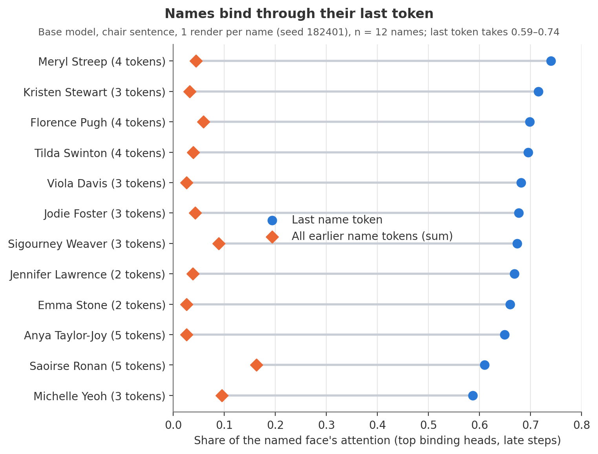
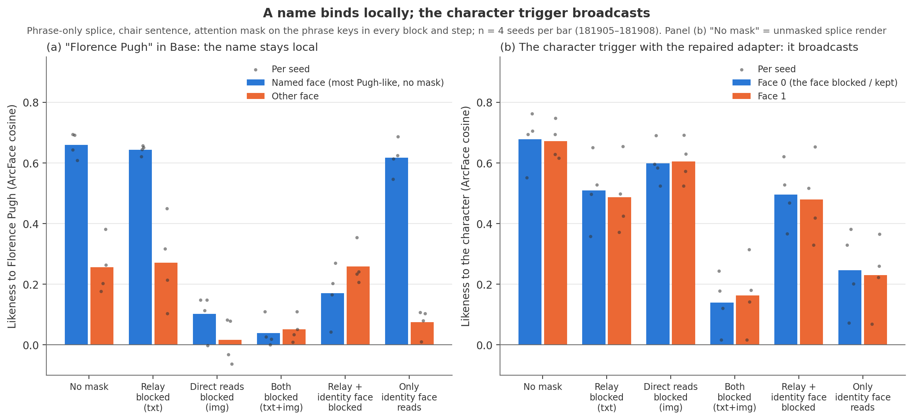
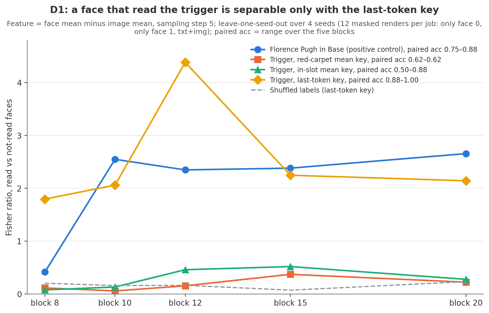
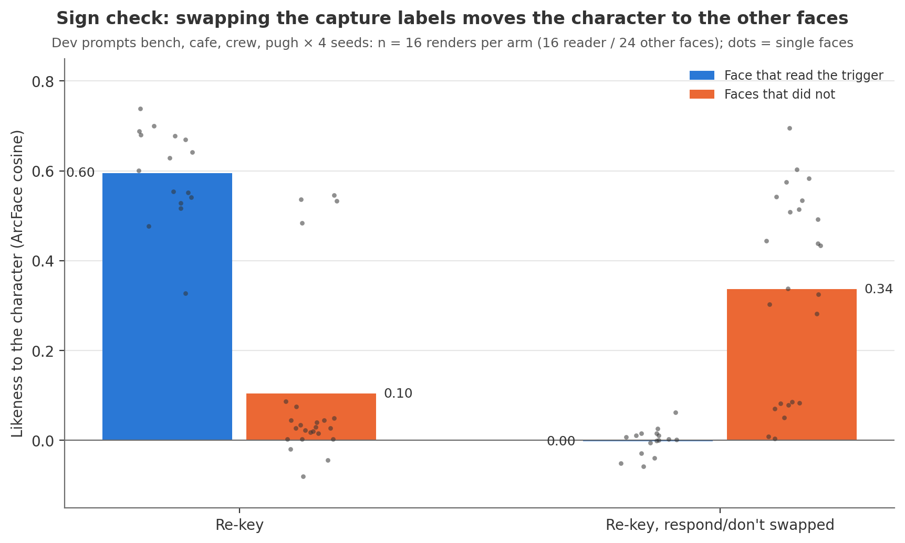
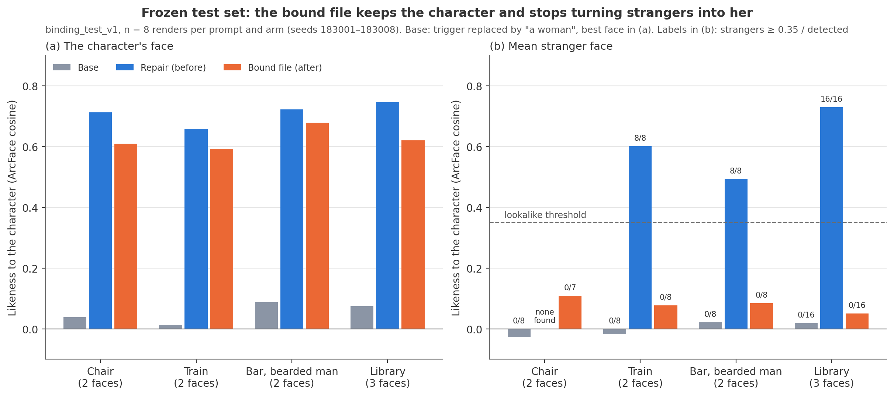

# Research lessons (October 2026)

Lessons from the delta-surgery research after the first release, in the order they were learned. The rendered case studies in DeltaScope cover several of them with images; this page keeps the short form and the numbers. All likeness values are ArcFace cosines against the character's reference centroid on Krea 2 Turbo renders unless stated otherwise.

## Broader capture wording can help some scenes and harm others

The [October prompt-coverage follow-up](prompt-dependent-preservation.md) compared revised and fresh-control captures at two reservoir seeds, with two paired render seeds per case. Under the shared CPU float64 solver, the revision improved beach likeness and three new-wording case means in both draws, but worsened the original space-station and wizard-workshop failures in every paired render. Pooling those cohorts would conceal the failed rescue. The intervention also changed appearance constraints and context coverage together, so it does not identify which wording component caused each change.

## Preserve numerical arithmetic when reproducing a repair

The stable CPU solver and historical mixed-precision solver implement the same objective but produced different weights on the saved real captures. Matching the original GPU float32/CPU float64 Cholesky path and its intermediate float32 cast reproduced all 256 historical A tensors exactly, then both beach prompt states produced identical decoded pixels to the historical adapter rerendered in the same server ([real-model check](real-model-validation.md)). Numerical settings belong in the experiment record alongside capture settings and inference strength. A more accurate linear solve does not by itself establish better rendered identity preservation.

## Local response alignment is not an identity score

In the same follow-up, revised-capture local response cosine fell on beach probe inputs while rendered beach likeness improved. The probe held source-adapter activations fixed and used a different runtime from Turbo generation. Its measurements describe local transforms; they do not establish a causal module or replace image-level evaluation.

## Localize with tensor swaps before solving anything (2026-10-19)

Hybrid adapters that take the original LoRA's factors in one block window and the repaired factors elsewhere (and the converse) cost one render each and localized the space-station failure to main blocks 8–15 in 128 renders; every other window, including blocks 0–3, did nothing. A cheap causal map like this should precede any new solver or attribution work.

## Input-statistics surgery fails where identity and a strong scene prior share directions

The blocks that restore triggered likeness in the failing scenes also restore the untriggered bleed (+0.19 to +0.30). A capture-based solve cannot separate a component that is both "the character overriding the scene's default face" and "the character leaking into generic prompts". Strong-prior contexts (sci-fi/fantasy "film still" prompts) expose this; adding the film-still sentence to a passing scene cuts post-surgery likeness by 0.15–0.26 while the original adapter is unaffected.

## Stress-test the trigger against named and described identities

After surgery the trigger lost to any directly described identity (a named actress: likeness ≈0; ethnicity descriptors: 0.01–0.31), while the original adapter overrode everything, triggered or not. Named-identity and descriptor prompts are a cheap check of trigger strength that the single-person diagnostics miss.

## Judge "who the face became" against concept centroids and baselines

The fallback face first looked like a 0.50 match to one same-scene, same-seed render of a named actress, inflated by shared pose and lighting. Against concept centroids (four studio portraits per identity) with stated baselines (different actresses 0.03–0.38 apart, a render vs another person ≈0.15, a person's own renders 0.75+), it was a consistent 0.30–0.34 lookalike within a blend of space-film actresses. Don't call a mid-range cosine "same" or "different person" without those baselines.

## Reproduce the frozen protocol before new probes

New probe renders reproduced the frozen study pixel for pixel (10 of 12); the two exceptions were the first render after each new LoRA load, with small detail differences. Check reproduction on a few cells first and treat first-after-load renders as slightly noisy.

## Select edits by measured effect (cross-project, from MOSS)

On MOSS-Image, a LoRA built by scoring each rank-1 piece of the fine-tuning change by the gradient of the unwanted behaviour (nynxz's method) undid 0.09 % of the change and drifted far less than location-based or input-statistics edits. The analogous character repair scores the removed pieces of blocks 8–15 per scene for likeness and bleed. See [attributions](attributions.md).

## Binding: names are entities to the text encoder (2026-10-21 → 10-25)

A character trigger written before the class word ("TRIGGER woman, …") acts as a modifier of the class and is drawn on every face in the picture. Names bind locally through dedicated attention heads (Krea 2 blocks 7–11, last token; MOSS-Image layers 17–29, whole name), and only names the text encoder knows as a specific person bind: invented and ordinary non-famous names bind no better than "a woman" on both models. Binding therefore has to be given (a closed-form key edit or an embedding pre-bind) or trained with per-face "don't" data; spelling and phrasing cannot buy it. Untriggered bleed lives in the block delta and is best prevented at training time (DOP), not repaired after.

*Base model, one render per name: for 12 of 12 celebrity names the named face's binding heads attend mostly to the name's last token (0.59–0.74 of the attention), not to the earlier tokens.*

*Attention masks on the phrase keys, four seeds per bar. (a) In Base, "Florence Pugh" stays on one face: blocking the relay through other text tokens changes nothing, blocking direct reads removes the name, and letting only the named face read it keeps her there (0.62 vs 0.07 on the other face). (b) With the earlier repaired adapter the trigger reaches both faces equally through both routes; even when only one face may read it, both faces keep the same likeness (0.25 / 0.23), and only blocking both routes removes it.*

*Linear probe on face features (sampling step 5, leave-one-seed-out over four seeds). Giving the trigger a name's last-token key makes the face that read it separable (paired accuracy 0.88–1.00), on par with a real name in Base; red-carpet and in-slot mean keys stay near the shuffled-label floor.*

The repair that followed is closed form and needs no masks at inference: (1) a key lock in all 28 blocks so the trigger presents a name's last-token key and one face reads it like a name; (2) an executor re-key of the image-side LoRA A factors (B unchanged) so the adapter responds only on the face that read the trigger; (3) the trigger amplifier applied to the trigger's own tokens only. All three fold into one ordinary LoRA file.

*Control: swapping the "respond" and "don't respond" capture labels of the re-key moves the identity from the reading face (0.60 vs 0.10 on the other faces) to the other faces (0.00 vs 0.34). The re-key does what its labels say.*

*Frozen test set, eight unseen seeds and unseen prompts. The bound file keeps the character's face (0.59–0.68, below the earlier repair's 0.66–0.75) and stops turning strangers into her: strangers at or above the 0.35 lookalike threshold fall from 32 of 32 to 0 of 39 detected stranger faces in the unnamed multi-person scenes.* Open problems: sentences that put a celebrity first, solo likeness below the earlier repair on three of four solo scenes (−0.07 to −0.21), and the untriggered bleed inherited from the repair's block LoRA (+0.065 mean on the 70-cell panel vs +0.048 for the repair).

## Train-time binding on MOSS-Image (2026-10-25/26, shelved)

1. Validate the identity metric by eye before reading it on a new model: MOSS pilot renders scored ArcFace 0.53–0.62 against an in-sample reference centroid but did not look like the character ("not at all", Dylan 2026-10-26). On a freshly trained adapter an in-sample centroid rewards the in-sample look; held-out references and an eye check come first.
2. Bind with the text rows, not the weights: an embedding pre-bind (a frozen offset on the name's 4 context rows) reached 0.283 / 0.058 binding with untriggered prompts bit-identical (0.00 px); the closed-form weight key lock reached 0.16–0.20 and moved every picture 8–25 px.
3. Leave routing to the base model when training identity: v/o + MLP adapters with q/k frozen kept binding at 0.21–0.27 vs 0.03–0.06 on other faces; training q/k in the binding layers dropped it to 0.13 / 0.12 by step 300.
4. A name gate isolates exactly: scaling the adapter per image patch by binding-head attention to the name kept untriggered renders at 0.0 px drift through 1500 steps (ungated variants 30–45 px) at ≈ 3 % step cost. It isolates the person, not her other learned attributes: those then land on her instead of spreading over the picture; co-present women still picked up +0.12.
5. Stacked anti-bleed losses can stop learning: composites + DOP + masked prior + Gram anchor achieved general wardrobe bleed cancelation but left likeness ≤ 0.04 after 1500 steps; DOP alone cut drift 2.6× and halved learning speed.
6. Without a pre-bind, training barely binds an invented name (0.026 / 0.021 after 1500 steps).
7. Measurement hygiene: labelling "her face" by likeness is a coin flip until likeness clears the base null (≈ 0.19), so label by layout; per-checkpoint "s/step" must exclude checkpoint time; resident Gram matrices plus a reloaded text encoder run a 32 GB card out of memory (free or unload around each checkpoint).
