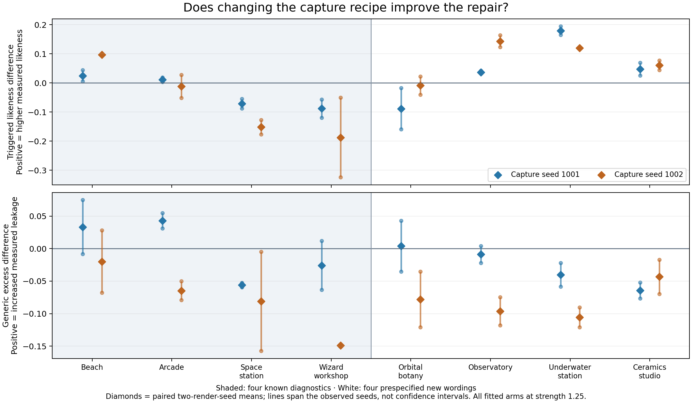
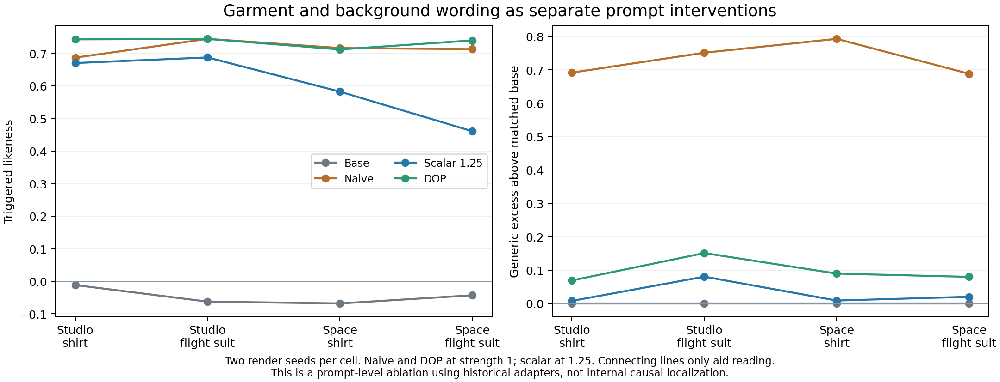
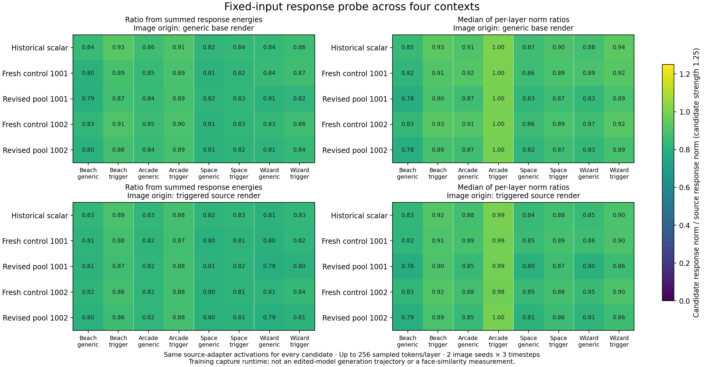

# Prompt-dependent preservation after scalar delta surgery

*Controlled scan-recipe follow-up — 17 October 2026. The raw records behind this note (per-image scores, capture protocol, frozen cells, probe tables, verification and timing logs) stay in the research archive; the figures and the summary numbers are reproduced here.*

The revised activation-capture recipe **did not rescue the original space-station and wizard-workshop failures** under the tested solver. Triggered face similarity fell against the matching fresh control in both capture draws and both render seeds for those scenes. Beach likeness improved in both draws. In a separate prespecified new-wording cohort, observatory, underwater-station and ceramics-studio means also improved in both draws, while orbital botany declined. Arcade changed direction between capture draws. The result is a context-dependent redistribution of measured performance, not a generally better repair.

A fixed-input probe found related changes in local BA responses, but it does not localize a cause or substitute for rendered outcomes. An additional numerical-reproducibility check identified a distinction between the historical solver arithmetic and the CPU float64 variant used for all four fresh repairs; the primary revised-versus-control comparisons remain matched within that variant.

## Motivation and capture audit

The motivating comparisons used one character, matched generic/triggered descriptions and two seeds. The same historical scalar checkpoint at strength 1.25 retained likeness near the original adapter on the beach and arcade while losing much of it in the space station and wizard workshop. The earlier five-scene observations are separate from the fresh rerenders below; the lighthouse was not selected for this follow-up. The values here preserve the original motivating measurements.

| Scene | Naive likeness, 1.0 | Historical scalar likeness, 1.25 | Scalar generic excess | DOP likeness, 1.0 |
|---|---|---|---|---|
| Beach | 0.6987 | 0.6714 | −0.0977 | 0.7020 |
| Arcade | 0.7636 | 0.7293 | −0.1033 | 0.7504 |
| Lighthouse | 0.6674 | 0.6236 | −0.0073 | 0.7366 |
| Space station | 0.6669 | 0.1343 | −0.0190 | 0.6982 |
| Wizard workshop | 0.7280 | 0.3323 | −0.0579 | 0.7470 |

Each entry is a two-seed mean with two detected faces or matched base pairs. Likeness is a raw face-embedding cosine; generic excess subtracts the exact generic base score. A negative excess means lower target-centroid similarity than base, not better overall preservation. The [creative-scene scores](../examples/creative-scenes/scores.json) in this repository cover the four creative scenes; the beach records stay in the research archive.

The historical prompt file contained 164 descriptions, but positional pairing with a 72-latent bank consumed only its first 72. The intended extra coverage never reached the capture. The audit tagged 71 of those 72 descriptions with stated age or age-category markers; triggered captions inherited the same attributes. Direct spaceflight and wizard-context examples were absent. The historical reservoir draw was unseeded. These are coverage concerns, not proof that any one omitted word or attribute caused the failures.

## Objective and controlled design

With captures stored as sample rows, surgery refits A while keeping B fixed:

```text
min_A′ ||A′Xcᵀ||² + μ||(A′−A)Xtᵀ||² + ε||A′||²
Gc = XcᵀXc; Gt = XtᵀXt
ε = ρ trace(Gc + μGt) / input_width
A′(Gc + μGt + εI) = μAGt
```

All four fresh arms use μ = 0.3, relative ridge ρ = 0.001 and a zero-centered prior. Render strength 1.25 is a separate multiplier on the finished adapter. At 1,024 captured rows per role, the combined matrix has rank at most 2,048. Across the historical 256 adapted modules, input widths 2,560 / 6,144 / 6,912 / 16,384 therefore imply joint-nullspace dimensions of at least 512 / 4,096 / 4,864 / 14,336. Zero-centered ridge sends the fitted A response to zero on that nullspace in exact arithmetic. These are coverage bounds, not semantic feature counts or evidence that those directions caused a specific failure.

The experiment crosses the reconstructed 72-description control pool with a revised 72-description pool at reservoir seeds 1001 and 1002. The revised pool combines removal of competing appearance constraints with broader context/attribute coverage; its components and wording-length changes are not isolated. Every arm reuses the same ordered 72-latent bank. The revised arm consequently changes any original caption/image semantic correspondence; it does not test a newly matched latent bank.

| Setting | Fixed value |
|---|---|
| Captures | 72 prompt/latent pairs per role; 1,024 rows per module and role |
| Noise and flow fractions | Seed 42; 0.10, 0.25, 0.40, 0.55, 0.70, 0.85 |
| Capture execution | Source LoRA at 1.0; microbatch 4; one PyTorch CPU thread |
| Capture runtime | Historical training-model condition, qfloat8 |
| Fresh solve | CPU float64 automatic primal/dual selection; dual for these matrices; checkpoint dtype restored |
| Rendering | Krea 2 Turbo; 832 × 1216; Euler/simple; 8 steps; CFG 1; denoise 1 |
| Strengths | Naive/DOP 1.0; historical scalar/deployment-fit and fresh repairs 1.25; base has no adapter |

The single-thread sampler was a recorded amendment before any completed fresh capture. The old vectorized duplicate-slot writes were nondeterministic at eight threads despite identical RNG states. Selecting accepted rows before transfer matched the unchanged single-thread reference byte-for-byte, including RNG state, in 108 CPU/CUDA cases. Both fresh recipes use the same implementation. Exact replay of the historical unseeded artifact is not claimed.

The historical scalar also used different numerical arithmetic: CUDA float32 primal Cholesky with TF32 disabled for input widths up to 8,192, CPU float64 primal solves above that width, and a float32 intermediate before checkpoint conversion. The fresh arms all use CPU float64 dual solves. This distinction was identified during compatibility work after the follow-up was run. The algebraic objective is shared, but comparing a fresh arm with the historical artifact changes both capture realization and solver arithmetic. Only the revised-versus-fresh-control comparison isolates the combined recipe under the fresh solver condition.

A separate check of the installed release's `--method historical`, reusing the saved historical captures, reproduced all 256 A tensors bit-for-bit and kept every non-A tensor unchanged. At beach seed 171018 and strength 1.25, both prompt states produced identical decoded pixels and face scores to the historical adapter rerendered in the same server: triggered 0.6780787706 and generic −0.0693126023. The triggered score also matches the earlier published value; the generic score differs slightly from its earlier −0.0708926469. This establishes historical arithmetic compatibility for those saved captures and the tested render pair; it does not rerun the four fresh repairs under that arithmetic or establish universal render determinism. The [real-model check](real-model-validation.md) records the tensor and paired render comparisons.

The frozen evaluation has three cohorts. Known diagnostics comprise beach, arcade, space station and wizard workshop at seeds 171017/171018. Held-out wording comprises orbital botany, observatory, underwater station and ceramics studio at 172101/172102. Each uses nine conditions and both trigger states, producing 144 images. The separate four-condition factorial ablation contributes 64 images, for 352 total. The held-out wording shares some scene families with the revised scan; it is not a broad semantic or cross-subject holdout. A capture protocol and a list of exact frozen cells, both written before rendering, define the experiment.

## Scoring and detection coverage

The CPU InsightFace/ArcFace evaluator uses the largest detected face and a normalized centroid of 34 reference embeddings. Native full-resolution images are scored. All 352 images have detections, so every primary row retains both paired render seeds. There are 351 single-detection images and one two-detection image: the historical scalar on triggered observatory, seed 172102. Its largest-face score is also its maximum-face score. No fresh control or revised image has multiple detections. The scorer reproduces all eight native calibration scores exactly.

Primary effects are revised minus fresh control at the same scene, capture seed and render seed. Likeness differences require both triggered detections. Generic-excess differences require revised, control and matching base detections; the same base cancels algebraically but remains part of the metric definition. No missing value is zero-filled. The two render seeds are the paired observations, not independent samples at every layer or every image crop.

## Rendered outcomes

Each table cell below is **Δ likeness / Δ generic excess**, averaged over two matched render seeds. Positive likeness is an increase in this measurement; positive excess is increased generic target similarity. All differences have 2/2 complete pairs.

### Known diagnostics

| Case | Capture 1001 | Capture 1002 |
|---|---|---|
| Beach | +0.0251 / +0.0332 | +0.0966 / -0.0198 |
| Arcade | +0.0115 / +0.0429 | -0.0113 / -0.0646 |
| Space station | -0.0708 / -0.0559 | -0.1518 / -0.0811 |
| Wizard workshop | -0.0881 / -0.0258 | -0.1873 / -0.1488 |

### Held-out wording

| Case | Capture 1001 | Capture 1002 |
|---|---|---|
| Orbital botany | -0.0884 / +0.0038 | -0.0088 / -0.0781 |
| Observatory | +0.0371 / -0.0089 | +0.1437 / -0.0961 |
| Underwater station | +0.1799 / -0.0401 | +0.1199 / -0.1057 |
| Ceramics studio | +0.0477 / -0.0641 | +0.0612 / -0.0434 |

Beach likeness increases in all four individual paired renders. Arcade has a small positive mean at capture 1001 and a mixed-sign, slightly negative mean at capture 1002. Space-station and wizard-workshop likeness decreases in every individual pair. Their lower generic-excess means therefore accompany a loss of requested likeness; suppression alone would mischaracterize the result. Fresh space-station revised means are −0.0948 and −0.1425, both valid detected-face cosines rather than missing values.

Observatory, underwater station and ceramics studio improve in every individual likeness pair. Their generic-excess means also decrease at both capture seeds. Underwater and ceramics show both changes in every individual pair; observatory has one small excess increase (+0.0042). Orbital botany declines on both means, with mixed individual signs at capture 1002. Underwater shows the largest consistent gain (+0.1799/+0.1199), but this does not establish equality with Naive or DOP.



*Diamonds are two-render-seed means; vertical spans show the two observed seeds, not confidence intervals. Shading separates known diagnostics from prespecified new wording.*

| Cohort | Capture seed | Equal-case mean Δ likeness | Equal-case mean Δ excess |
|---|---|---|---|
| Known diagnostics | 1001 | −0.0306 | −0.0014 |
| Known diagnostics | 1002 | −0.0635 | −0.0786 |
| Held-out wording | 1001 | +0.0441 | −0.0273 |
| Held-out wording | 1002 | +0.0790 | −0.0808 |

These are separate within-cohort descriptions, each with four fully paired cases. Pooling the cohorts would hide deterioration of the motivating failures behind gains elsewhere. The historical artifact is also an inadequate substitute for a fresh control: wizard likeness is 0.3323 for the historical scalar but 0.1823/0.3719 for the two fresh controls. Complete per-case means, paired seed rows, detector counts and native scores are kept with the raw records.

## Separate prompt-factor ablation

The 2×2 ablation crosses studio/space-station background and navy-shirt/flight-suit wording, retaining the other ablation text. It uses only Base, Naive 1.0, historical Scalar 1.25 and DOP 1.0 at seeds 172201/172202. It contains no fresh control/revised conditions and is not pooled with their cohorts.

| Condition | Naive: likeness / excess | Historical scalar | DOP |
|---|---|---|---|
| Studio / shirt | 0.6867 / +0.6917 | 0.6701 / +0.0076 | 0.7427 / +0.0689 |
| Studio / flight suit | 0.7443 / +0.7512 | 0.6873 / +0.0804 | 0.7441 / +0.1510 |
| Space / shirt | 0.7161 / +0.7927 | 0.5821 / +0.0087 | 0.7118 / +0.0894 |
| Space / flight suit | 0.7127 / +0.6882 | 0.4606 / +0.0199 | 0.7395 / +0.0796 |



For historical scalar, the background contrast is −0.0879 likeness with the shirt and −0.2267 with the flight suit. The difference-of-differences is −0.1387, with individual-seed values −0.1949/−0.0826. The flight-suit contrast is +0.0172 in studio and −0.1215 in space. Thus the selected wording factors interact; the flight suit alone does not reproduce the original severe failure. The combined ablation reaches 0.4606 likeness, above 0.1343 for the original space-station formulation, but those formulations and seeds differ. This does not identify a causal token or neural module. All factorial contrasts are kept with their individual seed values.

## Fixed-input responses and their limits

The probe uses 16 existing images: four known scenes × two seeds × generic-base or triggered-source origin. Both caption roles and three flow fractions (0.25/0.55/0.85) produce 96 forwards. The source adapter stays active at strength 1.0 in the historical training runtime. Source, historical scalar and all four fresh candidates transform identical captured inputs algebraically, with B unchanged. Candidate repairs never affect subsequent activations.

Up to 256 evenly spaced token rows are sampled per module; text-side modules contribute 91–133 rows here. Full BA energies and cross-products are computed through BᵀB, then summed before forming norm ratios, relative changes and cosines. The summaries also retain median per-module norm ratios. Candidate strength 1.25 is compared with source strength 1.0; cosine is invariant to that positive scale on fixed inputs. Zero-source norms remain undefined.

Historical scalar response cosine is lower in space station and wizard than in both beach and arcade in every image-origin/caption-role stratum. Revised-minus-control global cosine decreases in 31/32 context/capture-seed summaries, including 15/16 triggered summaries. These correlated summaries are not independent prompts. Fitting reports nevertheless retain strong in-sample metrics: median class-response ratios 0.00159–0.00189 and trigger cosines 0.999985–0.999991 across the four fresh arms.



*The plot shows norm ratios, not face similarity or response cosine. The sampling budget is up to 256 rows per module; text-side modules use fewer rows. These are fixed source-active inputs, not edited-model trajectories.*

The eight projection-suffix families are heterogeneous. Attention-query cosine decreases in all 32 matched family summaries; MLP-up decreases in 31. Attention-value instead increases in 15/16 triggered summaries while decreasing in 15/16 generic summaries. Each family combines 28 main-transformer and four text-fusion modules. These findings describe local transformations, not causal localization. Full context/family tables and input hashes preserve the complete comparison.

Beach demonstrates the limit of a simple local-alignment interpretation: triggered-response cosine falls at both capture seeds and both image origins, yet rendered likeness increases in all four paired images. The probe and renderer use different trajectories and model conditions. No held-out-wording scene was part of the probe, so its local measurements cannot explain those gains directly.

## Reproducibility and observed timings

The verification checks all four repair hashes, shapes/dtypes, 256 edited modules per arm and unchanged B/non-A tensors. Original metadata is retained with an added provenance entry. Every native image hash and saved graph matches its planned cell. Independent recomputation checked 16 primary summaries, 32 paired render rows, 88 supplementary summaries, 40 factorial means and 80 seed-level contrasts without a discrepancy above 10⁻¹². The verification and analysis records hold the evidence.

Supplementary rerenders are not exact historical replay. Of 48 shared creative-scene cells, 45 scores repeat exactly; three triggered-arcade images at seed 171017 differ by +0.00993 (Naive), +0.00939 (DOP) and +0.03190 (historical scalar), despite identical graphs. Of 20 shared beach cells, 16 repeat exactly; four triggered images at seed 171017 differ. Scorer calibration remains exact. Within-batch primary pairing is unchanged, but small effects should not be overinterpreted and earlier motivating values should not be overwritten.

Recorded wall times use one RTX 5090 32 GB and a Ryzen 7 9800X3D; stable solves use eight CPU threads. They are observations from this workstation, not controlled throughput benchmarks. Concurrent scoring is not an additional independent elapsed stage.

| Stage | Observed wall time | Scope |
|---|---|---|
| Each completed capture | 815–866 s | Four jobs; includes initialization and output |
| Each CPU float64 solve | 76–84 s | Four jobs; eight CPU threads |
| Fixed-input probe | 149 s | 96 forwards; includes startup |
| Rendering | 2,139 s | 352 images; excludes ComfyUI server startup |

The timing record retains individual jobs and measurement boundaries. The separate historical-compatibility solve took 264.6 seconds, including installed-CLI startup, input loading and hashes, solving, diagnostics and output writing; it reused saved captures. Its timing is separate from the four fresh-repair jobs above.

## Lessons from this intervention

The combined text-recipe change improved some cases while worsening the failures it was intended to address. A broader prompt pool, excellent fitting residuals and low generic identity excess were insufficient to establish preserved requested identity. Fresh matched controls exposed that result, while separate cohorts prevented a favorable aggregate from hiding it.

The conclusion is limited to one character, one fixed latent bank, two capture draws and two render seeds per case under the CPU float64 solver. Appearance wording, context coverage and prompt length changed together; no source-centered prior or newly matched latent bank was tested. Face scores do not measure image quality, attribute adherence or human judgments of likeness. The factorial results concern these prompt formulations, and the probe is descriptive rather than causal. A next study should vary one capture component or numerical condition at a time and retain both successful and failed diagnostic cases.
